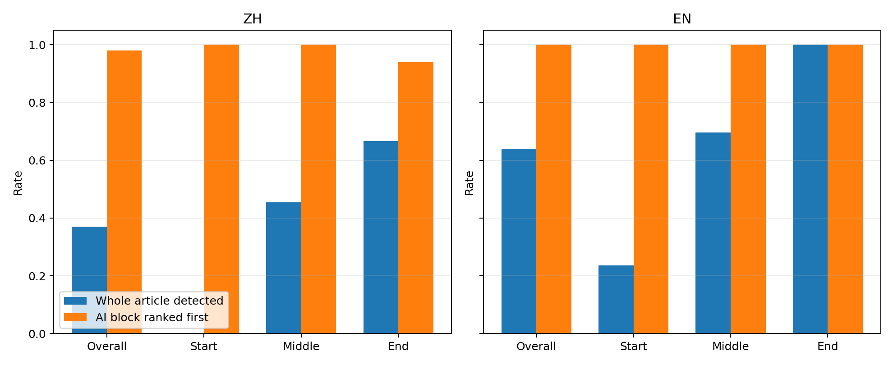
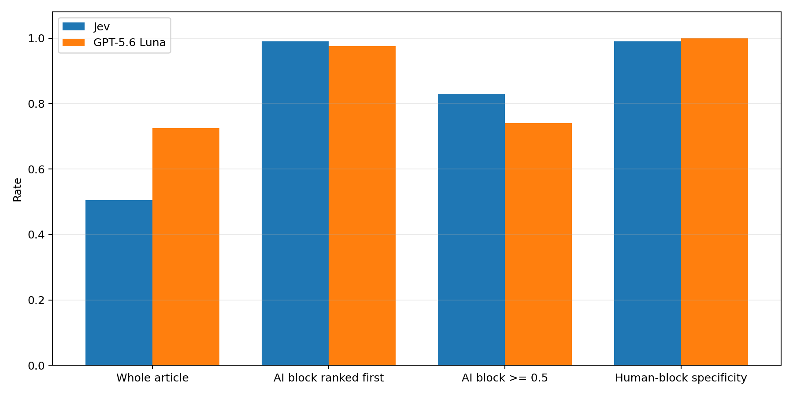

# Detecting and Localizing AI Rewrites in Chinese and English Prose

## 1. Objective

This experiment evaluates whether JEV can detect substantive GPT-4o-mini rewrites in Chinese and English human prose, localize a single rewritten block, and identify AI-rewritten sentences when human and AI sentences are interleaved. It also compares JEV with GPT-4o-mini and GPT-5.6 Luna on the same block-mixed corpus and tests whether adding one sentence of context on each side improves sentence classification.

Only completed and auditable work is included. The metadata field `samples: 16915` denotes completed model judgments, not independent documents. The corresponding detection calls used 10,041,972 input tokens and cost $0.694586612. Corpus-generation cost is reported separately.

## 2. Data and protocols

The source corpus contains 100 Chinese and 100 English human-written prose texts. Chinese texts contain 1,200–2,200 non-whitespace characters and English texts contain 800–1,500 words. Each text has at least six paragraphs and can be divided at paragraph boundaries into three balanced contiguous blocks.

The completed datasets are:

- **Full rewrite:** 100 human and 100 GPT-4o-mini-rewritten texts per language, plus their three-block versions.
- **One-block mix:** one of three blocks is rewritten while the other two remain unchanged. Ground-truth positions are allocated 34/33/33 across beginning, middle, and end for each language.
- **Sentence mix:** approximately one third of sentences are replaced with GPT-4o-mini rewrites, producing 200 mixed articles with 11,515 sentences: 3,844 AI and 7,671 human.
- **Three-sentence context:** 1,200 target-sentence judgments using the preceding, target, and following sentences while explicitly asking the detector to classify only the middle sentence.

All datasets use the what-the-jev `schema_version=1` format. The main threshold was fixed at 0.50 before analysis. For one-block localization, the primary ranking metric is whether the true AI block has a strictly higher probability than both human blocks.

The detectors were JEV `typesafe/jev-1.14-20261014`, GPT-4o-mini `openai/gpt-4o-mini-2024-07-18`, and GPT-5.6 Luna `openai/gpt-5.6-luna`. The two GPT baselines used temperature 0 and structured JSON output. All completed formal result files have zero terminal failures.

## 3. Main results

### Full human versus full AI rewrite

| Unit | Language | Accuracy | AI recall | Human specificity | ROC-AUC |
| --- | --- | ---: | ---: | ---: | ---: |
| Article | Chinese | 75.5% | 52.0% | 99.0% | 0.956 |
| Article | English | 99.5% | 99.0% | 100.0% | 1.000 |
| Block | Chinese | 76.7% | 54.7% | 98.7% | 0.952 |
| Block | English | 98.7% | 98.3% | 99.0% | 0.999 |

JEV separates the classes well by ranking, but the fixed threshold is conservative for Chinese rewrites.

### One-block mixed articles

JEV detected 101 of 200 mixed articles at the article threshold and strictly localized the true AI block in 198 of 200 articles.

| Language | Article detection | Block accuracy | Strict localization | AI-block recall | Human-block FPR | Block AUC |
| --- | ---: | ---: | ---: | ---: | ---: | ---: |
| Chinese | 37.0% | 88.0% | 98.0% | 66.0% | 1.0% | 0.980 |
| English | 64.0% | 99.3% | 100.0% | 100.0% | 1.0% | 1.000 |
| Overall | 50.5% | 93.7% | 99.0% | 83.0% | 1.0% | 0.993 |

Within-article ranking is therefore useful for localization when the design guarantees one AI block. It is not a general article-level detector because a ranking rule always selects a highest-scoring block, even in an all-human article.

### Same-corpus detector comparison

Each method completed the same 800 judgments: 200 articles and 600 blocks.

| Method | Article detection | Block accuracy | Strict localization | AI-block recall | Human-block FPR | Cost |
| --- | ---: | ---: | ---: | ---: | ---: | ---: |
| JEV 1.14 | 50.5% | 93.7% | 99.0% | 83.0% | 1.0% | $0.039666 |
| GPT-4o-mini | 26.5% | 60.8% | 20.0% | 9.0% | 13.2% | $0.109049 |
| GPT-5.6 Luna | 72.5% | 91.3% | 97.5% | 74.0% | 0.0% | $0.223469 |

Against GPT-4o-mini, JEV was significantly better on all five paired binary metrics. Against GPT-5.6 Luna, Luna's article detection was 22 percentage points higher. JEV's 2.3-point block-accuracy advantage and 1.5-point strict-localization advantage were not significant after Holm correction, while JEV's 9-point higher AI-block recall was significant. Block AUC was 0.993 for JEV and 0.992 for Luna.

The GPT-4o-mini direct-probability protocol showed output collapse, especially near 0 and 1, so its result applies to that model-prompt protocol rather than every possible GPT-4o-mini detector design.

## 4. Sentence mixing and context robustness

### Approximately 33% AI sentences

The 200 sentence-mixed articles produced 11,715 completed JEV judgments: 200 article judgments and 11,515 sentence judgments.

| Metric | Chinese | English | Overall |
| --- | ---: | ---: | ---: |
| Mixed-article detection | 23.0% | 71.0% | 47.0% |
| AI-sentence recall | 17.6% | 58.7% | 38.5% |
| Human-sentence specificity | — | — | 92.5% |
| Sentence-level F1 | — | — | 0.502 |

The fixed threshold performs poorly on interleaved sentences, particularly in Chinese. Ranking remains informative: mean within-article AUC is 0.817, top-k recall is 0.654 when k equals the known AI-sentence count, and AI sentences have a higher mean score than human sentences in 199 of 200 articles.

A post-hoc Chinese threshold of 0.31 raises recall to 78.3% but also raises the false-positive rate to 43.7%, so it is unsuitable for unattended classification. Short sentences, quotation or dialogue, and high 5-gram overlap with the source are the main observed difficulty factors.

### Three-sentence context

Adding one neighboring sentence on each side yielded mixed effects. Chinese accuracy increased 4.5 points and AI recall increased 12.67 points. English accuracy decreased 4.5 points and human specificity decreased 20.33 points. Overall accuracy was unchanged: 72 false negatives were recovered while 72 new false positives were introduced. Neighboring AI text can contaminate the target-sentence judgment, so a universal three-sentence window is not supported by these results.

## 5. Cost

| Stage | Requests | Input tokens | Cost |
| --- | ---: | ---: | ---: |
| Main full/block/method comparison | 4,000 | 4,230,200 | $0.450492 |
| JEV sentence-mixed experiment | 11,715 | 5,195,141 | $0.218196 |
| JEV three-sentence context | 1,200 | 616,631 | $0.025899 |
| Completed detection total | 16,915 | 10,041,972 | $0.694587 |

For the same 800 one-block judgments, GPT-4o-mini cost 2.75 times as much as JEV and GPT-5.6 Luna cost 5.63 times as much. Corpus generation cost an additional $0.371988, giving $1.066575 in audited API cost for the completed detection and corpus-generation scope. This excludes taxes, payment fees, exchange-rate effects, local computation, labor, and exploratory calls outside the formal result files.

## 6. Conclusion

JEV is effective and inexpensive for block-level ranking and localization in this corpus, but article-level and sentence-level fixed-threshold detection are substantially weaker. The strongest supported workflow is to split text into meaningful units, rank the units by suspicion, combine ranking with an absolute threshold, and send candidates to human review.

For one-block mixtures, JEV provides a better cost-effectiveness trade-off than the tested GPT baselines. GPT-5.6 Luna has higher article recall, whereas JEV has lower cost and higher AI-block threshold recall; their block ranking performance is statistically indistinguishable under this study. Sentence interleaving is much harder, and adding neighboring context does not provide a stable overall improvement.

These conclusions apply only to the completed corpus and protocols. All AI rewrites were generated by GPT-4o-mini; human post-editing and academic-paper prose were not evaluated. Older source texts may also have appeared in model training data. GPT-5.6 Luna was called through a non-dated OpenRouter alias, so future reruns may be affected by model-version drift.

## Related material

- [Full-rewrite results](JEV_RESULTS.md)
- [One-block mixed results](MIXED_JEV_RESULTS.md)
- [JEV versus GPT-4o-mini](JEV_VS_GPT4OMINI.md)
- [JEV versus GPT-5.6 Luna](JEV_VS_GPT56LUNA.md)
- [Paired statistical tests](PAIRED_STATISTICAL_TESTS.md)
- [Sentence-mixed results](SENTENCE_MIXED_JEV_RESULTS.md)
- [Sentence threshold, factor, and error analysis](JEV_SENTENCE_DEEP_ANALYSIS.md)
- [Three-sentence context results](CONTEXT_WINDOW_JEV_RESULTS.md)

