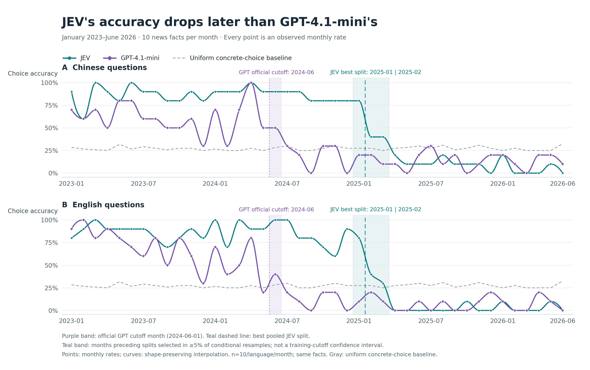
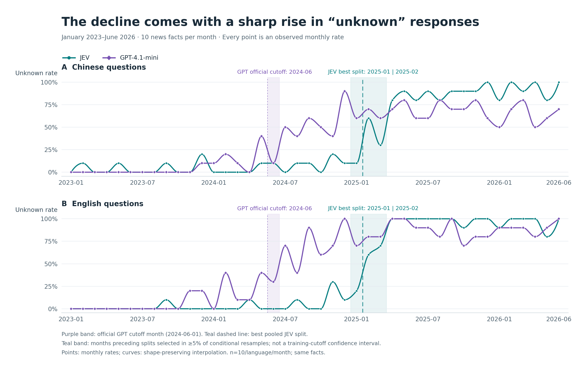
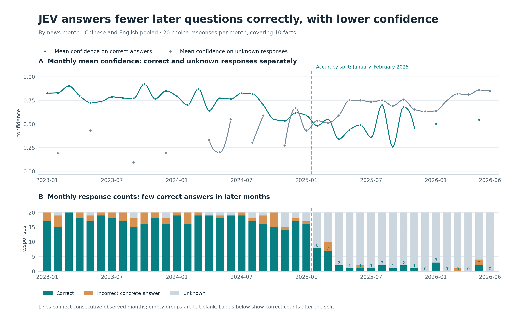

# JEV Knowledge Cutoff Estimate

## 1 Purpose

This experiment estimates **JEV's knowledge cutoff date**. It asks about news facts first made public in different months, looking for a sustained increase in errors or “unknown” responses. Questions focus on the central facts of widely reported stories that month.

GPT-4.1-mini has an official knowledge cutoff of June 1, 2024. We give it the same questions to check whether the method finds a transition near a known cutoff, providing a reference for assessing the JEV estimate.

## 2 Dataset

The dataset covers **42 months, from January 2023 through June 2026**. Each month contributes ten news facts, each expressed as one multiple-choice question and one true/false question. These question types are paired by fact. The same set is available in Chinese and English, with **420 multiple-choice questions and 420 true/false questions per language, or 840 questions in total**. JEV and GPT-4.1-mini therefore each answer **1,680 questions**.

Facts are assigned to the month when the answer first became public. Topics include election winners, sports champions, major award recipients, and the locations of major events. Each fact retains reports from at least two independent news publishers to verify the answer and when it became public.

Question design serves the cutoff estimate: stories should be prominent, answers should first become public in the assigned month, and distractors should be plausible. This reduces two sources of error: missing a fact because it is obscure, and selecting the correct answer by eliminating obviously implausible alternatives without knowing the news.

Multiple-choice questions offer concrete answers and an “unknown” option. True/false questions state a fact about the same story; each month has five true statements and five with a key detail changed to make them false. Questions are answered independently, without news sources, reference answers, or responses to other questions. The language versions cover the same facts, so there are still only ten independent facts per month.

The JEV version tested is `typesafe/jev-1.13-20260917`.

## 3 Minimal Example

Here is an English multiple-choice question about a January 2025 news event. The input sent to JEV is:

```json
{
  "state": "Near which US city did an airliner collide with an Army helicopter and crash into a river in January 2025?",
  "questions": {
    "answer": {
      "type": "choice",
      "instructions": "Choose the only correct concrete option for the historical knowledge question in state; choose unknown if unsure.",
      "criteria": {
        "A": "Washington, D.C.",
        "B": "New York",
        "C": "Philadelphia",
        "D": "Chicago",
        "unknown": "Cannot determine / do not know"
      }
    }
  }
}
```

The reference answer is A. The relevant fields from JEV's response are:

```json
{
  "choice": "A",
  "probabilities": {"A": 0.71, "B": 0.07, "C": 0.01, "D": 0.01, "unknown": 0.2},
  "confidence": 0.64
}
```

The paired true/false question states that the collision occurred near Washington, D.C. The reference is true. JEV returns `noul=0.64`, assigning a 64% probability that the statement is true.

## 4 Results

### Accuracy: JEV's transition occurs in early 2025

Answers are scored against the dataset's references, with “unknown” counted as not correct. Figure 1 shows multiple-choice accuracy for both models by news month.



Pooling Chinese and English responses, JEV achieves 86.3% accuracy on news from 2023–2024 and still reaches 80.0% for January 2025. Accuracy falls to 37.5% for February–March and just 5.3% from April through the end of the dataset. Fitting a change point to monthly accuracy places the boundary **between January and February 2025**.

The control model, GPT-4.1-mini, has its pooled accuracy change point **between June and July 2024**, near its official cutoff month. This supports using the same method to estimate JEV's cutoff.

### Abstention: JEV increasingly answers “unknown” as accuracy falls



JEV answers “unknown” on only 4.0% of questions about 2023–2024 news. This rises to 15.0% for January 2025, 55.0% for February–March, and 93.3% from April onward. The change point in abstention also falls **between January and February 2025**, agreeing with the accuracy estimate. GPT-4.1-mini's abstention change point falls between June and July 2024, likewise agreeing with its accuracy change point.

For news from February 2025 onward, JEV assigns a probability below 50% to the statement being true in 338 of 340 true/false responses. Converting these probabilities to true/false answers at a 50% threshold yields roughly 50% accuracy. Because the statements are balanced between true and false, always choosing false would achieve the same accuracy. This result does not establish that JEV knows half of the later news.

### Confidence: correct answers to later questions are generally less certain

Accuracy alone cannot show whether the few correct answers to later questions might be guesses. Figure 3 plots JEV's monthly mean confidence separately for correct answers and “unknown” responses, alongside the number of responses in each category.



Using the January–February 2025 boundary, mean confidence on correct answers falls from **0.759 to 0.508**. The decrease also appears in each language separately. After the boundary, JEV answers correctly 31 times: 15 have confidence below 0.5, while three still have confidence of at least 0.8. Correct answers to later questions are less confident overall and may include guesses. A few such answers alone do not justify moving the estimated cutoff beyond those events.

Mean confidence across all responses, however, barely changes: 0.705 before the boundary and 0.694 afterward. The figure shows that later responses with high confidence are predominantly “unknown,” which is why they need to be separated from correct answers.

Confidence on correct answers starts declining in late 2024, before the sharp drop in accuracy, and later monthly averages contain very few correct answers. It provides supporting evidence of greater uncertainty but does not independently locate the cutoff month.

### Stability of the estimate

Restricting the analysis to questions with four concrete options leaves both JEV change points between January and February 2025. Analyzing each language separately also leaves the Chinese results unchanged. English accuracy shifts the boundary to February–March, while English abstention still places it between January and February.

### Call cost

JEV completes 1,680 responses, using **630,658 input tokens** and **59,332 output tokens**. The total cost recorded in successful responses is **USD 0.026487636**.

## 5 Conclusion

**JEV's estimated knowledge cutoff is early 2025, with the main transition between January and February.** Falling accuracy and rising abstention both point to this period. Lower confidence on correct answers to later questions provides supporting evidence. GPT-4.1-mini shows a transition near its known cutoff month, providing a control for the method.

## Related Resources

- GPT-4.1-mini official model documentation: https://developers.openai.com/api/docs/models/gpt-4.1-mini
