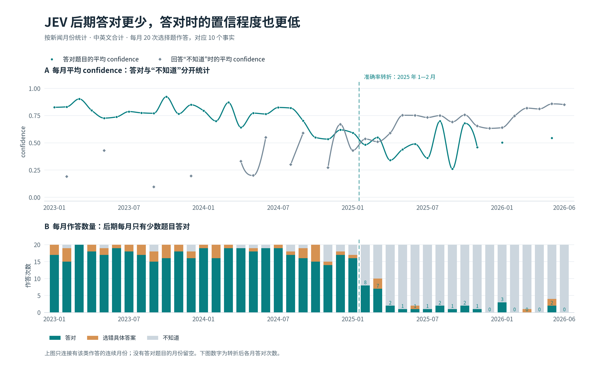

# JEV 知识截止日期估计

## 1 实验目的

本实验估计 **JEV 的知识截止日期**。方法是让模型回答不同月份新公开的新闻事实，观察它从什么时候开始持续答错或回答“不知道”。选题以当月广泛报道、最容易接触到的新闻为主，询问核心事实。

GPT-4.1-mini 的官方知识截止日期为 2024 年 6 月 1 日。本实验让它回答相同题目，检验这种方法能否在已知截止时间附近找到转折，再据此判断对 JEV 的估计是否可信。

## 2 数据集

题库覆盖 **2023 年 1 月至 2026 年 6 月，共 42 个月**。每月选取 10 个新闻事实，各出一道选择题和一道判断题，两种题型一一对应。同一套题目分别提供中文和英文版本，每种语言有 **420 道选择题、420 道判断题，共 840 道题**。因此，JEV 与 GPT-4.1-mini 各回答 **1,680 道题**。

事实按答案首次公开的月份归入题库，选题以重大新闻的核心结果为主，包括选举胜者、赛事冠军、重要奖项得主和重大事件发生地。每个事实保留至少两家独立新闻发布方的报道，用于核对答案和公开时间。

题目设计围绕截止日期估计展开：新闻要有足够的知名度，答案要在对应月份才首次公开，干扰项要足够合理。这样可以减少两种干扰：模型因为题目冷门而答错，以及模型没有见过新闻却凭明显不合理的选项排除出答案。

选择题提供具体候选和“不知道”选项。判断题把同一新闻写成一句陈述，让模型判断真假；每月 5 道陈述符合事实，另 5 道改错其中的关键信息。各题独立作答，不附新闻来源、标准答案或其他题目的回答。中英文对应同一批事实，每月仍只有 10 个独立事实。

本次测试的 JEV 版本为 `typesafe/jev-1.13-20260917`。

## 3 最小示例

下面是一道关于 2025 年 1 月新闻的中文选择题。发给 JEV 的输入如下：

```json
{
  "state": "2025年1月，美国一架客机与陆军直升机在机场附近相撞坠河，事故发生在哪座美国城市附近？",
  "questions": {
    "answer": {
      "type": "choice",
      "instructions": "选择state中历史知识题唯一正确的具体选项；无法确定时选择unknown。",
      "criteria": {
        "A": "华盛顿",
        "B": "纽约",
        "C": "费城",
        "D": "芝加哥",
        "unknown": "无法确定／不知道"
      }
    }
  }
}
```

标准答案为 A。JEV 返回的关键字段如下：

```json
{
  "choice": "A",
  "probabilities": {"A": 0.52, "B": 0.24, "C": 0.03, "D": 0.02, "unknown": 0.19},
  "confidence": 0.4
}
```

对应的判断题陈述是“2025年1月，美国客机与陆军直升机在机场附近相撞坠河的事故发生于华盛顿附近。”，标准答案为真。JEV 返回 `noul=0.47`，即给出 47% 的为真概率。

## 4 结果

### 准确率：JEV 的转折出现在 2025 年初

以题库标准答案为判据，选择“不知道”计入未答对。图 1 展示两种模型对不同月份新闻的选择题准确率。


JEV 对 2023—2024 年新闻的中英文合计准确率为 86.3%，对 2025 年 1 月新闻仍有 80.0%；2—3 月降至 37.5%，4 月至题库末尾仅为 5.3%。对逐月准确率拟合转折点，得到的边界位于 **2025 年 1 月与 2 月之间**。

对照模型 GPT-4.1-mini 的合计准确率转折位于 **2024 年 6 月与 7 月之间**，落在官方截止月份附近。这为同一方法估计 JEV 的截止日期提供了支持。

### 弃答比例：准确率下降时，JEV 开始大量回答“不知道”


JEV 对 2023—2024 年新闻仅有 4.0% 的回答是“不知道”；2025 年 1 月为 15.0%，2—3 月升至 55.0%，4 月以后达到 93.3%。弃答比例的转折同样位于 **2025 年 1 月与 2 月之间**，与准确率给出的估计一致。GPT-4.1-mini 的弃答转折则位于 2024 年 6—7 月之间，也与其准确率转折一致。

2025 年 2 月以后的 340 次判断题回答中，有 338 次给出的为真概率低于 50%。若以 50% 为阈值将概率换算为真假答案，JEV 的准确率约为 50%。由于题目真假各半，始终选“假”也能达到这一水平，因此这一准确率不能说明 JEV 知道一半后期新闻。

### 置信程度：后期即使答对，通常也不如早期确信

只看准确率，还无法判断后期少量答对的题目是否可能是猜中的。图 3 按新闻月份分别统计 JEV 答对时和回答“不知道”时的平均 confidence，并列出每月的作答数量。



以 2025 年 1—2 月之间为界，JEV 答对题目的平均 confidence 从 **0.759 降至 0.508**，中英文分别统计也都有下降。边界之后共答对 31 次，其中 15 次 confidence 低于 0.5，仍有 3 次不低于 0.8。后期正确答案的把握程度总体较低，其中可能包含猜中的答案，不能仅凭少量答对就把截止日期推迟到这些事件发生之后。

全部回答的平均 confidence 却没有明显下降：边界前为 0.705，之后为 0.694。图中可以看到，后期高置信回答主要是“不知道”，所以必须把它与答对题目的置信程度分开看。

答对题目的 confidence 在 2024 年末已经开始降低，早于准确率的明显转折；后期每月又只有少量题目答对。因此，它能佐证后期回答更不确定，但不能单独确定截止月份。

### 估计的稳定性

只保留四个具体选项的题目，JEV 的准确率与弃答转折仍位于 2025 年 1—2 月之间。按语言分别分析，中文结果不变；英文准确率的转折后移到 2—3 月之间，弃答转折仍在 1—2 月之间。

### 调用成本

JEV 完成 1,680 次作答，消耗输入 **630,658 token**、输出 **59,332 token**，成功响应记录的总费用为 **0.026487636 美元**。

## 5 结论

**JEV 的知识截止日期估计在 2025 年初，主要转折位于 1 月与 2 月之间。** 准确率下降和弃答增加共同指向这一时间；后期答对题目的置信程度也较低，提供了辅助证据。GPT-4.1-mini 在其已知截止月份附近出现转折，为这一估计方法提供了对照。

## 相关资料

- GPT-4.1-mini 官方模型说明：https://developers.openai.com/api/docs/models/gpt-4.1-mini
