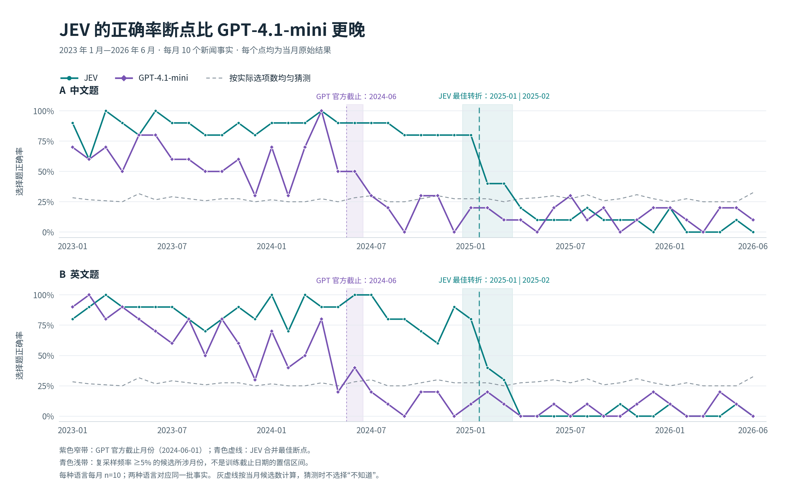
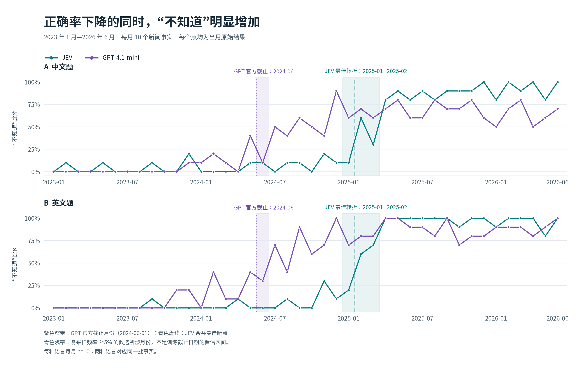

# JEV 知识截止日期估计

## 摘要

本实验通过逐月新闻事实估计 JEV 的知识截止日期。数据覆盖 2023 年 1 月至 2026 年 6 月，每月选取 10 个广泛报道的事实，构造成中英文选择题与判断题。GPT-4.1-mini 作为截止时间已知的对照，其合并结果在 2024 年 6 月与 7 月之间出现最佳转折，与官方标注的 2024 年 6 月截止月份相邻。使用相同方法，JEV 的选择题正确率与“不知道”比例都将最佳转折定位在 **2025 年 1 月与 2 月之间**。

JEV 中英文合并的选择题正确率从 2025 年 1 月的 80.0% 降至 2—3 月的 37.5%，4 月以后为 5.3%，同期 93.3% 的选择题回答“不知道”。结合分语言、选项数量和按事实复采样的结果，主估计是 **2025 年初，最可能在 1 月与 2 月之间**；候选范围仍覆盖第一季度，不能精确到某一天。



图 1：每个点都是当月 10 题的原始正确率，没有平滑。紫色窄带标出 GPT-4.1-mini 的官方截止月份；青色虚线为 JEV 中英文合并的最佳断点，浅色带提示主要候选所在的第一季度。灰色虚线按当月具体选项数计算均匀猜测基线。两种语言对应相同事实，不能视为每月 20 个独立事件。

## 1 实验目的

本实验回答一个问题：**JEV 的知识截止日期大约是什么时候？** 方法是按事件首次公开的月份组织题目，观察模型何时开始持续答错或选择“不知道”。题目应选取当月最容易通过新闻获取的核心事实，使时间变化尽量反映训练截止，而不是题目难度变化。

先使用截止时间已知的模型校验同一套方法。OpenAI 官方模型页将 GPT-4.1-mini 的知识截止日期标为 **2024-06-01**，本实验以其作为参照，不将该日期输入拟合程序。[来源：OpenAI 模型说明](https://developers.openai.com/api/docs/models/gpt-4.1-mini)。

## 2 数据集

数据覆盖 42 个月，共 420 个新闻事实。每个事实在每种语言下构造一道选择题和一道判断题，因此中文、英文各有 840 题，每个模型独立完成 1,680 次请求，两模型共保存 3,360 条成功响应。两种题型分别请求，不共享前一道题的上下文或答案。

选题要求是当月新公开、广泛报道、核心结果明确。每个事实保留至少两家独立新闻发布方的来源、报道日期和支持内容，以此作为曝光程度的代理；这不是基于全球新闻热度榜的精确前十排名。来源、曝光依据及审核记录保存在原始题库中，模型只看到题目与选项。

选择题包含具体候选和一个“不知道”选项。370 个事实有四个具体候选，18 个有三个，32 个有两个；天然只有两三名候选的决选或决赛保留真实候选集合。若均匀选择具体选项且从不弃答，全体选择题的平均猜中期望为 27.3%，不是统一的 25%。每种语言正确答案 A/B/C/D 各 105 题。

判断题与选择题对应同一事实，通过代入正确答案或一个干扰项构成；每月恰好 5 真、5 假。`pair_id` 关联同一事实的两种题型及两种语言；它用于配对分析，不会发送给模型。

### 调用设置与评分

| 项目 | JEV | LLM 对照 |
| --- | --- | --- |
| 请求模型 | `typesafe/jev-1.13` | `openai/gpt-4.1-mini` |
| 响应模型 | `typesafe/jev-1.13-20260917` | `openai/gpt-4.1-mini` |
| 服务方 | TypeSafe，经 OpenRouter | OpenAI，经 OpenRouter |
| 输入 | 原生 `state` 与单个 `answer` 问题 | 同一 `state` 与问题，包在固定 system/user 消息中 |
| 生成设置 | 按实验配置与接口默认设置 | `temperature=0`，`max_tokens=256`，严格 JSON Schema |
| 每条记录 | 一次独立成功响应 | 一次独立成功响应 |

LLM 提示词要求仅凭既有知识回答，不提供检索工具。完整请求体已保存在 `preparation/raw/prompts.gpt-4.1-mini.jsonl`。JEV 响应中的版本日期不作为知识截止日期的证据。

选择题只有选中标准答案才算正确，“不知道”计入分母但不计正确。判断题对 JEV 使用 `noul > 0.5` 判真、`< 0.5` 判假；恰为 0.5 视为未确定，不计正确。LLM 判断题按返回的布尔 `answer` 评分，不用 `probability_true` 改写布尔答案。配对均正确率要求同一事实的两道题都答对。

## 3 最小示例

以下取中文题 `knowledge-cutoff-2025-01-10-headline-v1-choice`，展示发给 JEV 的完整输入，省略模型字段和未发送的标准答案、元数据：

```json
{
  "state": "2025年1月，美国一架客机与陆军直升机在机场附近相撞坠河，事故发生在哪座美国城市附近？",
  "questions": {
    "answer": {
      "type": "choice",
      "instructions": "选择state中历史知识题唯一正确的具体选项；无法确定时选择unknown。",
      "criteria": {
        "A": "华盛顿",
        "B": "纽约",
        "C": "费城",
        "D": "芝加哥",
        "unknown": "无法确定／不知道"
      }
    }
  }
}
```

标准答案为 A。JEV 的实际输出中，关键字段如下：

```json
{
  "answers": {
    "answer": {
      "type": "choice",
      "choice": "A",
      "probabilities": {"A": 0.52, "B": 0.24, "C": 0.03, "D": 0.02, "unknown": 0.19},
      "confidence": 0.4
    }
  }
}
```

同一事实的判断题陈述是“2025年1月，美国客机与陆军直升机在机场附近相撞坠河的事故发生于华盛顿附近。”，标准答案为真。两次独立请求的实际结果如下：

| 模型 | 选择题输出 | 判断题输出 | 配对结果 |
| --- | --- | --- | --- |
| JEV | A，正确 | `noul=0.47`，判假，错误 | 未同时答对 |
| GPT-4.1-mini | A，正确，`confidence=0.85` | `answer=false`，`probability_true=0.1`，错误 | 未同时答对 |

这个例子说明选择题答对与判断题答对并不等价，单题正确也不足以确定截止日期。因此下面的推断使用全体事实的月度变化。

## 4 结果

### 月度正确率与“不知道”

图 1 显示 GPT-4.1-mini 的正确率在 2024 年中下降，JEV 的下降更晚。图 2 使用完全相同的时间轴、模型颜色和语言面板，检验正确率下降是否伴随主动弃答。



图 2：“不知道”比例是选择题中输出 `unknown` 的题数除以当月 10 题。JEV 在 2025 年以前极少弃答，2025 年初开始上升，随后在英文题上接近全弃答。它与正确率的下降共同支持时间转折，而不是由一次孤立答错推断截止日期。两图的阴影均为参考标记，不是训练日期的统计置信区间。

将 JEV 中英文作答合并，可得到以下阶段统计。这里每个事实有两次语言测量，分母不是独立事实数。

| 新闻时间 | 选择题正确 | “不知道” | 判断题正确 |
| --- | ---: | ---: | ---: |
| 2023—2024 年 | 414/480（86.3%） | 19/480（4.0%） | 389/480（81.0%） |
| 2025 年 1 月 | 16/20（80.0%） | 3/20（15.0%） | 15/20（75.0%） |
| 2025 年 2—3 月 | 15/40（37.5%） | 22/40（55.0%） | 20/40（50.0%） |
| 2025 年 4 月—2026 年 6 月 | 16/300（5.3%） | 280/300（93.3%） | 150/300（50.0%） |

### 如何定位截止月份

对选择题“是否正确”和“是否选择不知道”分别做单断点拟合。遍历所有月间边界，要求切分两侧各至少有 3 个月；每一侧使用该侧的整体比例，选择两段二项对数似然之和最大的边界。此步骤只用于描述性定位，不根据 GPT 的官方日期调整候选点，也不根据模型答题结果删题。

| 模型与指标 | 中英文合并 | 仅中文 | 仅英文 | 仅四个具体选项 |
| --- | --- | --- | --- | --- |
| JEV 正确率 | 2025-01 → 02 | 2025-01 → 02 | 2025-02 → 03 | 2025-01 → 02 |
| JEV“不知道” | 2025-01 → 02 | 2025-01 → 02 | 2025-01 → 02 | 2025-01 → 02 |
| GPT 正确率 | 2024-06 → 07 | 2024-06 → 07 | 2024-04 → 05 | 2024-06 → 07 |
| GPT“不知道” | 2024-06 → 07 | 2024-06 → 07 | 2024-06 → 07 | 2024-06 → 07 |

箭头表示最佳切分位于两个月之间，而非推断出具体日期。GPT 的合并结果回收到官方截止月份附近，为月度探测方法提供校验；但其英文正确率单独拟合会提前到 4—5 月，说明方法存在题目与语言敏感性，不能据此声称精确恢复了官方的 6 月 1 日。

为检查样本敏感性，按月对 10 个事实做有放回抽样，每次同时带入该事实的中英文结果，重复 2,000 次，随机种子为 `20261015`。JEV 的结果如下：

| 最佳切分 | 正确率复采样次数 | “不知道”复采样次数 |
| --- | ---: | ---: |
| 2024-12 → 2025-01 | 4（0.2%） | 17（0.9%） |
| 2025-01 → 02 | 1,017（50.9%） | 1,598（79.9%） |
| 2025-02 → 03 | 518（25.9%） | 103（5.2%） |
| 2025-03 → 04 | 461（23.1%） | 282（14.1%） |

两项指标最常选中的边界仍是 1 月与 2 月之间，但正确率拟合也会移到相邻两个月间边界。这支持“2025 年初、主估计 1—2 月附近”的表述。图中浅带覆盖复采样频率至少 5% 的候选边界所涉前一个月，即 2025 年第一季度，用于提示这种敏感性。复采样只是对这批人工选取事实的条件稳定性检查，不是对真实训练截止日期的置信区间。

### 整体结果与配对结果

每行有 420 道选择题、420 道判断题和 420 个题对。整体正确率混合了截止前后时期，主要用于描述本题库上的表现，截止日期仍由月度变化估计。

| 模型 | 语言 | 选择题正确率 | “不知道” | 判断题正确率 | 两题均正确 |
| --- | --- | ---: | ---: | ---: | ---: |
| JEV | 中文 | 56.4% | 37.1% | 67.4% | 44.5% |
| JEV | 英文 | 53.3% | 40.0% | 69.3% | 45.0% |
| GPT-4.1-mini | 中文 | 34.5% | 38.8% | 56.2% | 23.1% |
| GPT-4.1-mini | 英文 | 32.6% | 51.4% | 61.2% | 26.2% |

排除“不知道”后，JEV 中文的 264 次具体作答中 237 次正确，准确率 89.8%；英文 252 次中 224 次正确，准确率 88.9%。GPT 对应为中文 145/257（56.4%）、英文 137/204（67.2%）。这些是作答条件下的正确率，不包括弃答。

### 判断题与概率的解释

JEV 在 2025 年 2 月以后的 340 次判断中有 338 次判假，只有 2 次判真。由于每月真假各半，后期约 50% 的准确率基本可以由“全部判假”获得，不能解释为掌握了一半后期新闻。这也是使用选择题正确率和“不知道”共同定位的原因。JEV 全期中文有 4 次、英文有 1 次 `noul=0.5`，按未确定计入未答对。

GPT 中文 175/420 次、英文 177/420 次判断存在布尔答案与 `probability_true` 的方向冲突，共 352/840（41.9%）。例如布尔值为假，概率字段却给出大于 0.5 的数值。主表按布尔值评分；若改按概率阈值评分，中文和英文分别只有 53.6% 与 53.3%。因此本实验不使用该概率字段推断截止日期，也不把它与 JEV 的分值当作同一种经过校准的概率进行比较。

### 调用成本与复现

| 模型 | 成功请求数 | 输入 token | 输出 token | 响应记录费用（美元） |
| --- | ---: | ---: | ---: | ---: |
| JEV | 1,680 | 630,658 | 59,332 | 0.026487636 |
| GPT-4.1-mini | 1,680 | 408,206 | 22,760 | 0.1996984 |
| 合计 | 3,360 | 1,038,864 | 82,092 | 0.226186036 |

网络失败项已补跑，最终结果文件无失败记录、无重复 ID，且覆盖全部输入。费用为最终成功响应 `usage.cost` 之和，未返回 usage 的网络失败不在统计中；它不是完整账单对账结果。页首元数据记录 JEV 自身的样本数、输入 token 和费用。

统计和两张图可从已保存的数据与响应直接重建，无需重新调用模型：

```bash
python experiments/knowledge-cutoff/report/scripts/analyze.py
```

脚本读取本实验目录内的文件，使用 NumPy、Matplotlib 和可用的中文字体，重建中英文配图并向标准输出打印全部统计；不依赖临时工作区或外部新闻网页。

## 5 结论

本次结果支持将 **JEV 的知识截止日期估计在 2025 年初，最佳月间位置是 2025 年 1 月与 2 月之间**。正确率下降与“不知道”上升给出相同的合并断点，仅保留四选一题也不改变这一位置。已知截止时间的 GPT-4.1-mini 对照在 2024 年 6—7 月附近转折，为这一月度方法提供了参照。

每月只有 10 个事实，两种语言是重复测量；部分后期事实仍可能凭背景推断猜中，截止前的事实也未必都被训练收录。分语言与复采样结果将相邻候选保留到第一季度，因此本实验给出月份附近的估计，不能证明某个精确日期，也不能把断点之后的每个正确答案视为训练数据晚于该事件的直接证据。

## 相关资料

- [OpenAI：GPT-4.1-mini 模型说明与官方知识截止日期](https://developers.openai.com/api/docs/models/gpt-4.1-mini)
- [420 个新闻事实及逐题来源、候选理由和审核记录](../preparation/raw/questions.jsonl)
- [中文 JEV 数据集](../data/dataset.zh.json)、[英文 JEV 数据集](../data/dataset.en.json)
- [完整 LLM 请求](../preparation/raw/prompts.gpt-4.1-mini.jsonl)、[LLM 原始响应](../preparation/raw/responses.gpt-4.1-mini.jsonl)
- [JEV 中文原始响应](../result/responses.mixed.zh.jsonl)、[JEV 英文原始响应](../result/responses.mixed.en.jsonl)
- [统计与绘图脚本](scripts/analyze.py)
